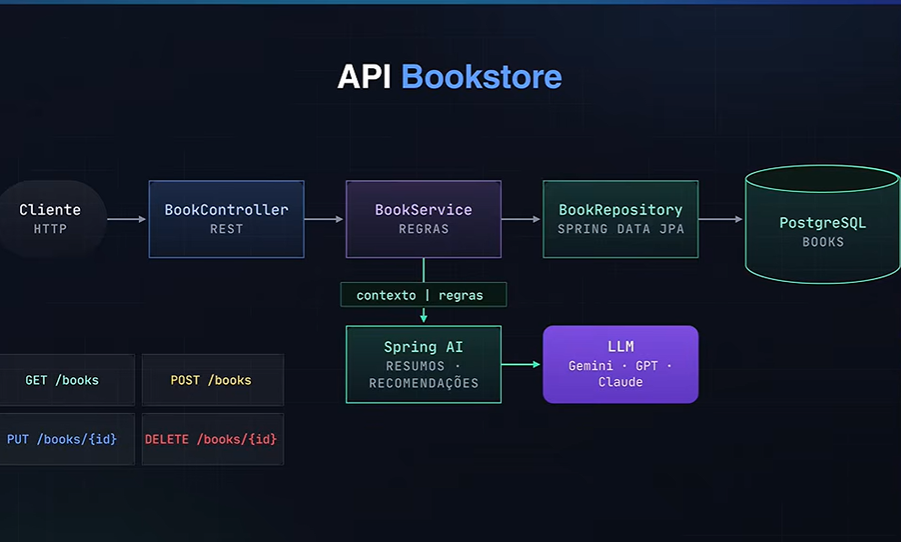

# Bookstore API – Spring Boot, PostgreSQL e Gemini

API REST de gerenciamento de livros desenvolvida com Spring Boot, PostgreSQL (Neon) e integração com Gemini 3.5 Flash Lite para geração automática de resumos após o cadastro.


---

## Funcionalidades

- Geração automática de resumo por IA após a criação do registro
- Persistência em banco PostgreSQL hospedado na Neon

---

## Stack

- **Spring Boot**
- **PostgreSQL (Neon)**
- **Google Gemini 3.5 Flash Lite**

### Detalhes técnicos

- **Java 27**
- **Spring Boot 4.1.1** (starters `webmvc`, `validation` e `data-jpa`)
- **Spring Data JPA / Hibernate** – schema gerado automaticamente (`ddl-auto: update`)
- **Spring AI 2.0.1** com o starter Google GenAI (`spring-ai-starter-model-google-genai`), usando o modelo `gemini-3.5-flash-lite`
- **Bean Validation** (Jakarta Validation) para validar a entrada
- **Versionamento de API** nativo do Spring (header `X-API-VERSION`, configurado em `WebConfig`)
- **Maven** (com Maven Wrapper)
- Configuração sensível via arquivo `.env` (modelo em `.env.example`)

---

## Arquitetura

O projeto segue uma arquitetura em camadas: **controller → service → repository**.



| Camada | Pacote | Responsabilidade |
|---|---|---|
| Controller | `controllers` | Traduz HTTP em chamadas ao service e devolve a resposta |
| Service | `services` | Regras de negócio e geração do resumo por IA |
| Repository | `repositories` | Acesso a dados com Spring Data JPA |
| Model | `models` | Entidade JPA `BookModel` (tabela `tb_books`) |
| DTO | `dtos` | Record de entrada `BookRecordDto`, com validações |
| Config | `configs` | Configuração do versionamento de API (`WebConfig`) |

**Decisões do projeto:**
- Identificadores do tipo **UUID**.
- Os controllers retornam a entidade diretamente (não há DTOs de saída).
- Os dados são copiados do DTO para a entidade com `BeanUtils.copyProperties`.
- O resumo (`review`) é gerado **somente na criação**. Se a chamada à IA falhar, o livro é salvo mesmo assim, com `review` nulo.

---

## Como rodar o projeto

### Pré-requisitos

- Java 27
- Um banco PostgreSQL (o projeto usa o [Neon](https://neon.tech), mas qualquer PostgreSQL funciona)
- Uma chave de API do [Google Gemini](https://aistudio.google.com/apikey)

### Passo a passo

1. **Clone o repositório**

   ```bash
   git clone git@github.com:wendersonw007/bookstore.git
   cd bookstore
   ```

2. **Crie o arquivo `.env`** a partir do modelo e preencha os valores (o `.env` já está no `.gitignore`):

   ```bash
   cp .env.example .env
   ```

   ```properties
   DB_URL=jdbc:postgresql://<host>/<database>?sslmode=require
   DB_USER=<usuario>
   DB_PASSWORD=<senha>
   GEMINI_API_KEY=<sua-chave-gemini>
   ```

3. **Suba a aplicação**

   ```bash
   ./mvnw spring-boot:run
   ```

   No Windows: `mvnw.cmd spring-boot:run`

A API fica disponível em `http://localhost:8080`. A tabela `tb_books` é criada automaticamente na primeira execução.

> Também há uma coleção do Postman pronta em [`API.postman_collection.json`](API.postman_collection.json). Ela salva o `id` do livro criado e reaproveita nas demais requisições.

---

## Exemplos de uso da API

Base URL: `http://localhost:8080`

A versão da API é informada pelo header `X-API-VERSION`. Se o header não for enviado, a versão padrão é `v1`. A versão `v2` já é aceita na configuração, mas todos os endpoints atuais estão em `v1`.

| Método | Endpoint | Descrição | Sucesso |
|---|---|---|---|
| `POST` | `/books` | Cadastra um livro e gera o resumo por IA | `201 Created` |
| `GET` | `/books` | Lista todos os livros | `200 OK` |
| `GET` | `/books/{id}` | Busca um livro pelo id | `200 OK` |
| `PUT` | `/books/{id}` | Atualiza um livro | `200 OK` |
| `DELETE` | `/books/{id}` | Remove um livro | `200 OK` |

### Campos de entrada

| Campo | Tipo | Regras |
|---|---|---|
| `title` | String | obrigatório, até 150 caracteres |
| `author` | String | obrigatório, até 100 caracteres |
| `publisher` | String | obrigatório, até 100 caracteres |
| `publicationYear` | Integer | obrigatório, positivo |

Requisições com campos inválidos retornam `400 Bad Request`.

### Cadastrar um livro

```bash
curl -X POST http://localhost:8080/books \
  -H "Content-Type: application/json" \
  -H "X-API-VERSION: v1" \
  -d '{
    "title": "Dom Casmurro",
    "author": "Machado de Assis",
    "publisher": "Editora Garnier",
    "publicationYear": 1899
  }'
```

Resposta `201 Created`:

```json
{
  "id": "3f1c2b9e-8a4d-4c6e-9b1f-2d7a5e8c0a11",
  "title": "Dom Casmurro",
  "author": "Machado de Assis",
  "publisher": "Editora Garnier",
  "publicationYear": 1899,
  "review": "Bentinho, já idoso, narra sua juventude e o casamento com Capitu, ..."
}
```

### Listar todos os livros

```bash
curl http://localhost:8080/books
```

Resposta `200 OK`: um array com os livros no mesmo formato acima.

### Buscar um livro pelo id

```bash
curl http://localhost:8080/books/3f1c2b9e-8a4d-4c6e-9b1f-2d7a5e8c0a11
```

Resposta `200 OK` com o livro. Se o id não existir, `404 Not Found`:

```
Book not found.
```

### Atualizar um livro

```bash
curl -X PUT http://localhost:8080/books/3f1c2b9e-8a4d-4c6e-9b1f-2d7a5e8c0a11 \
  -H "Content-Type: application/json" \
  -d '{
    "title": "Dom Casmurro",
    "author": "Machado de Assis",
    "publisher": "Companhia das Letras",
    "publicationYear": 2016
  }'
```

Resposta `200 OK` com o livro atualizado. O `review` existente é mantido.

### Remover um livro

```bash
curl -X DELETE http://localhost:8080/books/3f1c2b9e-8a4d-4c6e-9b1f-2d7a5e8c0a11
```

Resposta `200 OK`:

```
Book deleted successfully.
```

---

## Testes

Para rodar os testes e o build completo:

```bash
./mvnw verify
```

Situação atual: existe apenas o teste `contextLoads`, que verifica se o contexto do Spring sobe corretamente. Ele precisa do `.env` configurado, porque conecta no banco e configura o cliente da IA.

A cobertura com testes unitários e de integração está listada nos próximos passos.

---

## Próximos passos

- [ ] Testes unitários do `BookService` com Mockito (mockando o repositório e o `ReviewService`)
- [ ] Testes de integração dos endpoints com MockMvc e Testcontainers (PostgreSQL)
- [ ] Tratamento global de erros com `@RestControllerAdvice` e respostas de erro padronizadas
- [ ] Tratamento robusto de falhas da IA: retentativa, circuit breaker ou fila de reprocessamento
- [ ] Paginação e ordenação na listagem de livros
- [ ] Documentação interativa com OpenAPI / Swagger UI
- [ ] Docker e Docker Compose para subir a aplicação com um único comando
- [ ] Pipeline de CI com GitHub Actions
